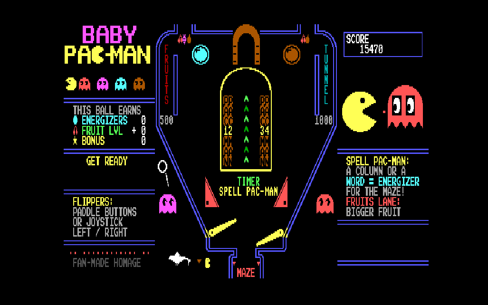
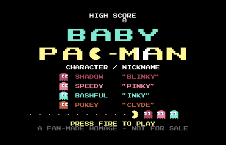
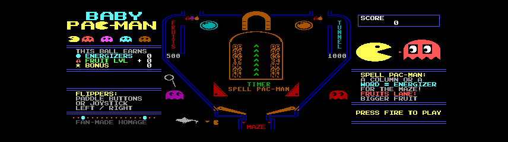
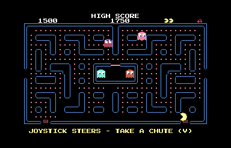
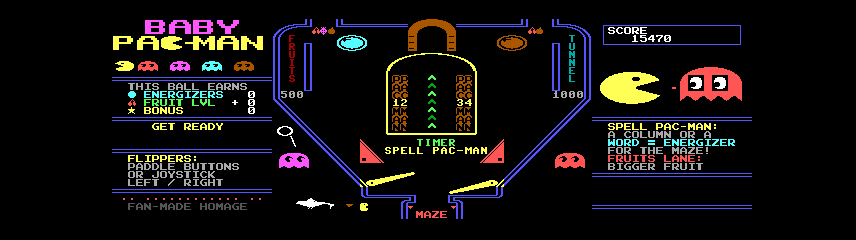

# Baby Pac-Man for the Commodore 128



*The pinball half, on the 80-column screen, as captured from the VICE emulator and rescaled to 4:3.*

A non-commercial homage to Bally Midway's 1982 **Baby Pac-Man**, the arcade hybrid with a video maze on top of a little pinball table. The Commodore 128 has two independent video chips, the 40-column VIC-IIe and the 80-column VDC, and this project puts the maze on one and the pinball on the other. Go down a chute and the maze freezes while the ball launches on the second screen. Drain the ball and you are back in the maze. It is written in 6502 assembly, with our own code and our own pixel art, as a tribute for the Vintage Computer Federation museum and the C128 community.

**Status in one line:** it runs in the VICE x128 emulator. It has **not yet been tested on real Commodore 128 hardware**. See [Status and honesty](#status-and-honesty).

## Contents

- [What the game is](#what-the-game-is)
- [Screenshots](#screenshots)
- [How to run it](#how-to-run-it)
- [Installing on a real C128 (step by step)](#installing-on-a-real-c128-step-by-step)
- [Controls](#controls)
- [How it works](#how-it-works)
- [Building from source](#building-from-source)
- [Project layout](#project-layout)
- [Status and honesty](#status-and-honesty)
- [Real hardware: photos coming soon](#real-hardware-photos-coming-soon)
- [Roadmap](#roadmap)
- [Credits](#credits)
- [Trademark and IP disclaimer](#trademark-and-ip-disclaimer)
- [License](#license)

## What the game is

- **The maze** is on the 40-column VIC-IIe screen: Pac-Man, four ghosts (Blinky, Pinky, Inky and Clyde, in their colors), dots, energizers, fruit, and two chutes in the bottom wall. The maze is our own redrawn layout that fits one 40x25 screen. It is not the arcade maze.
- **The pinball** is on the 80-column VDC screen: a short table with two flippers, pop bumpers, slingshots, side lanes (FRUITS and TUNNEL), and a block of eight PAC / MAN targets. The ball launches by itself. There is no plunger, and there are no outlanes, only a center drain.
- **One game plays while the other is frozen.** Pac-Man steers into an open chute, the maze dims and freezes, the pinball brightens, and after a short "GET READY" the ball drops in. When the ball drains down the middle, the pinball freezes and dims, and the maze resumes with Pac-Man just above the chute he took. Draining the ball does not cost a life. Lives are lost only in the maze.
- **The two halves feed each other.** Completing a column or a word of PAC / MAN targets earns an energizer for the maze, and lighting the FRUITS lane makes the maze fruit better. Earned energizers appear in empty maze corners (up to four, extras are worth points). After a pinball visit the chutes stay shut until you lose a life or clear the board.
- **Three lives**, a score shared between both screens, a high score kept until power-off, and an idle timeout of 60 seconds that ends an abandoned game.

The rules are our own tribute choices. We have not checked them against the arcade machine, and several come from memory of how the arcade works. This is not a reproduction of the arcade game or its ROM.

## Screenshots

All screenshots are from the VICE emulator, not real hardware. The in-game ones come from unattended test runs, in which an autopilot steered Pac-Man and a bot worked the flippers, not from a person playing.

| 40-column VIC screen: title | 80-column VDC screen: table, waiting at the title |
|---|---|
|  |  |

| 40-column VIC screen: the maze | 80-column VDC screen: the table in play |
|---|---|
|  |  |

The hero image at the top is the same table rescaled to 4:3, which is closer to how a monitor shows it.

## How to run it

The disk images are in [`release/`](release/). The recommended one is **`art3-sound.d64`** (or `.d71`, the same files in 1571 format). It holds four programs:

| Program | What it is |
|---|---|
| `BABY PAC-MAN` | The full game, maze and pinball (114 blocks) |
| `PINBALL` | The pinball table on its own (66 blocks) |
| `VDCTEST` | Diagnostic for the 80-column chip: VDC RAM size, RAM test, speed test, color bars |
| `DUALDEMO` | Diagnostic that animates both screens and shows joystick and paddle input |

The game only runs on a **C128 in C128 mode, NTSC**, with an **80-column monitor that takes the VDC's RGBI color output** as well as the 40-column monitor. The PAL case has not been built or tested. It also needs a joystick and, optionally, paddles (see [Controls](#controls)).

### In VICE (x128)

Install [VICE](https://vice-emu.sourceforge.io/) 3.10 (we used it on macOS via Homebrew: `brew install vice`). From the repo root:

```sh
x128 -ntsc -drive9type 1571 -9 release/art3-sound.d64 -keybuf 'dload"baby pac-man",u9\nrun\n'
```

This attaches the image as a 1571 on device 9, types the load command for you, and runs it. VICE opens two windows: the VIC window shows the maze and the VDC window shows the pinball. In our VICE tests the program started roughly 16 to 19 seconds after `RUN` (with true drive emulation on). Add `-VDC16KB` to emulate a 16K VDC (the game is designed to fit a 16K VDC, and we tested both 16K and 64K in VICE).

To use paddle fire buttons as flippers in VICE, add `-controlport1device 2`. Without it, joystick left and right also work the flippers.

### On a real Commodore 128 with a 1571 (device 9)

Put the disk (`.d64` written to a real disk, or the `.d71`) in the drive, set to device 9, and from C128 BASIC 7.0:

```
DLOAD "BABY PAC-MAN",U9
RUN
```

For the pinball alone, use `DLOAD "PINBALL",U9`. These names match what is on the disk, and there is no `.PRG` suffix on a real disk. If your drive is device 8, use `U8`.

The program takes over the machine and never returns to BASIC. **To leave it, press the RESET button.** RUN/STOP and RESTORE are ignored on purpose. The game never writes to the disk.

Load time on a real 1571 has not been measured. The `BABY PAC-MAN` program is 114 blocks, so expect it to take a while.

**This has not been confirmed on real hardware as of 2026-10-27.** If you try it, please report what you see, with photos. There are known unknowns listed below.

## Installing on a real C128 (step by step)

You need two things: the disk image on something the C128 can read, and the right cables and controllers. Nothing gets installed on the computer itself. The game loads from the drive into RAM each time and never writes to the disk.

### 1. Get the disk image

Download `art3-sound.d64` from the [latest release](https://github.com/nickdnj/baby-pac-man-c128/releases) (or the `.d71`). The fallback disks (`art2-pinball`, `tier3-babypac` and the rest) are in the repo's [`release/`](release/) folder. Then pick one way to get it into a drive:

| If you have... | Do this |
|---|---|
| **An SD-card drive (SD2IEC, uIEC, or similar)** | Copy the `.d64` onto the SD card. Put the card in, mount the image with the drive's own buttons or menu, and note its device number (often 8). Then load with `U8` instead of `U9`, or change the device number to 9. This is the easiest route. |
| **An Ultimate-II+ cartridge, Ultimate 64, or Pi1541** | Put the `.d64` on its storage and mount it as drive 9 in its menu. |
| **A real 1571 and a PC or Mac with a ZoomFloppy or XUM1541 cable** | Put a blank, formatted 5.25" disk in the drive and write the image with OpenCBM: `d64copy art3-sound.d64 9` (use the drive's device number). A single-sided `.d64` is a 1541-format disk, which a 1571 reads in 1541 mode. We have not tried this on a real 1571. |
| **A volunteer with a C64/C128 disk-transfer kit** | Hand them the `.d64`. Ask for a copy of the disk as-is, not a file copy. |

A plain file copy of the `.d64` onto a real floppy does not work. The image has to be written as a disk image, track by track.

### 2. Connect the machine (power OFF)

- **Joystick in port 2.** It steers Pac-Man and starts the game.
- **Paddles in port 1.** The fire buttons work the flippers. Joystick left/right also works the flippers if the paddles do not respond.
- **40-column monitor** on the composite or RGB video port: the maze.
- **80-column monitor** on the RGBI (digital) port: the pinball. It must take the VDC's RGBI color signal to show color.
- **Drive** on the serial cable. The commands below assume device 9. If it is device 8, use `U8`.

### 3. Turn it on

1. Turn the monitors and the drive on. Turn the C128 on last. Use **C128 mode** (not C64 mode, and not GO64).
2. Turn the monitor **volume down** first. This version plays sound, and nobody has heard it on a real machine yet.
3. Type `DIRECTORY U9` and press RETURN. You should see four programs: `VDCTEST`, `DUALDEMO`, `PINBALL` and `BABY PAC-MAN`.

### 4. Load in this order

Each line is typed at the BASIC prompt, then press RETURN. For every new program, the cleanest start is to power off, wait five seconds, and power on.

| Step | Type | Then | What you should see |
|---|---|---|---|
| 1 | `DLOAD "VDCTEST",U9` | `RUN` | A text report on both screens, a green border, and 16 color bars. Proves the 80-column screen and its RAM. |
| 2 | `DLOAD "DUALDEMO",U9` | `RUN` | A bouncing ball on each screen. Lets you test the joystick and paddles. |
| 3 | `DLOAD "PINBALL",U9` | `RUN` | The pinball table on the 80-column screen. |
| 4 | `DLOAD "BABY PAC-MAN",U9` | `RUN` | The maze on the 40-column screen. Press joystick FIRE to start. This is the biggest program (114 blocks), so give it up to a minute. |

Do not touch anything while the drive light is on.

### 5. Leaving a program

- `VDCTEST` and `DUALDEMO`: RUN/STOP + RESTORE, or reset.
- `PINBALL` and `BABY PAC-MAN`: **only the RESET button works.** RUN/STOP and RESTORE are disabled on purpose.

### 6. If something goes wrong

Try these disks in order (same commands): `art2-pinball`, then `art-babypac` or `art-pinball`, then the plain `tier3-babypac`, `tier2-pinball` and `tier1-diag`.

| Symptom | Likely cause |
|---|---|
| `FILE NOT FOUND` | The device number is wrong (try `U8`), or the name is off. Check with `DIRECTORY U9`. |
| Blank 80-column screen | Wrong monitor port, or the monitor does not take RGBI. Try `VDCTEST` first. |
| Pinball is black and white | The monitor is taking a composite or mono signal, not RGBI. |
| Game feels slow or jerky | Take a photo of the `PINBALL MAX / PEAK / SLOW FRAMES` line on the 40-column screen and send it in. |
| Keys and joystick do nothing | Check the joystick is in port 2. Power-cycle before trying again. |

The printable [museum field sheet](docs/museum-field-sheet.md) has the same steps plus a list of photos to take.

## Controls

| Input | Where | Action |
|---|---|---|
| Joystick (port 2) | Maze | Steer Pac-Man |
| Joystick fire (port 2) | Title | Start a game |
| Paddle fire buttons (port 1) | Pinball | Left button is the left flipper, right button is the right flipper |
| Paddle fire button (port 1) | Title | Start a game |
| Joystick left / right (port 2) | Pinball | Fallback: flips the left or right flipper |
| RESET | Any time | Leave the program |

The paddle knobs are not used. The ball launches without any button.

The paddle button and port-1 line assignments were written from memory. Our unattended emulator runs never exercised real presses, so joystick and paddle input is untested, in VICE and on real hardware.

## How it works

The interesting constraints, and how they are handled. The full design is in [`docs/architecture.md`](docs/architecture.md), and day-to-day decisions and measurements are in [`docs/dev-notes.md`](docs/dev-notes.md). The dev notes describe what was actually built, and where they differ from the architecture document, the dev notes are right.

**Two video chips, one CPU.** The VIC-IIe and the VDC each refresh their own screen from their own memory without help from the CPU. That is what makes the "freeze" free: only one game simulates at a time, and the other game's last image simply stays on its monitor. The program runs at **1 MHz** throughout, because 2 MHz mode would garble the VIC display, and the frozen maze must stay readable.

**No interrupts, no KERNAL.** The programs disable interrupts at start, bank the ROMs out, and use their own tiny vectors. Timing comes from polling the VIC raster, once per frame at line 251. Input is read directly from the CIA, and sound is ticked from the main loop. This was chosen for simplicity and determinism.

**The maze** uses a custom character set on the VIC in bank 3 (screen at `$C000`, characters at `$C800`, sprite shapes at `$E000`). Pac-Man, the ghosts and the fruit are VIC hardware sprites. The maze is generated at build time by `tools/mkmaze.py`.

**The pinball** is a VDC **text-mode** table, because the VDC has no hardware sprites. Table art is a custom 8x8 character set in VDC memory, with one foreground color per cell on a single background color. The table is 40 columns wide, in the middle of the 80-column screen, with the side panels on the left and right. The **ball is a software sprite**: a small glyph composed into a spare character slot from the cells underneath it, and rewritten for the union of its old and new cells each frame. The flippers are three pre-drawn poses each, redrawn only where the cells differ. Physics is integer fixed-point math: gravity, rebounds from the table's wall and bumper shapes, flipper kicks that depend on where the ball meets the flipper, a speed cap so the ball cannot tunnel, and a watchdog that nudges, then drains, a stuck ball. The table art and map are generated by `tools/mktable2.py`.

**No VDC block copy or fill.** The VDC can copy and fill memory in hardware, but corruption from block copies has been reported on real C128DCR hardware while working fine in VICE. We have not reproduced that problem ourselves. As a precaution, the game never uses these operations. Every VDC byte goes through a status-poll and the data register, which is slower but sidesteps the question. The library also gives up cleanly (the maze still plays, the chutes stay shut) if the VDC never answers.

**Cycle budget.** A frame on an NTSC machine is 17,045 cycles. VDC writes are expensive: in VICE we measured about 35 cycles per byte for a tight sequential run, and about 250 cycles for a random single-cell poke (which needs a new address). So the renderer favors short sequential runs, updates only the cells that changed, and spreads text redraws across frames. In VICE with a bot playing, the pinball frame costs a median of about 13,700 cycles and a peak of about 16,700, with no frame over budget in our test runs. VICE's VDC timing is not authoritative, and the real chip may be faster or slower. A pinball frame that goes over budget is exactly what the real-hardware test will show. The 40-column screen shows PINBALL MAX / PEAK / SLOW FRAMES counters so a visitor or a developer can see it live.

**Sound** is the SID: a maze siren, dot chomp, flipper thwack, bumper pings and a start fanfare. It is our own effects and our own fanfare, not the arcade tune.

## Building from source

You need the cc65 toolchain, VICE (for `c1541` to build disks and `x128` to run them), and Python 3 (to generate table and maze data). On macOS:

```sh
brew install cc65 vice
```

The Makefile assumes Homebrew's `/opt/homebrew/bin`, and the project was built with cc65 2.19 and VICE 3.10.

| Target | What it does |
|---|---|
| `make` / `make all` | Builds the three early "tier" disks into `build/` (`tier1`, `tier2`, `tier3`). These use the **first-generation art and the first table**, not the current look. |
| `make art3-sound` | **Builds the current recommended disk** (table v2 plus sound) into `build/` and **copies it to `release/art3-sound.d64` and `.d71`, overwriting those files**. |
| `make art2-pinball`, `make art-babypac`, `make art-pinball` | Older art-pass images, each copied into `release/`. Because they rebuild from the current source, they now include sound. |
| `make release` | Builds tiers 1 to 3 and **copies them over `release/tier1-diag.*`, `release/tier2-pinball.*` and `release/tier3-babypac.*`, overwriting the known-good tier images already there.** Do not run it casually. |
| `make run-vdctest`, `make run-dualdemo` | Run the diagnostics in VICE. |
| `make clean` | Removes `build/`. |

Test-only builds (an autopilot Pac-Man and an automatic flipper player, used for unattended emulator testing) are built along the way as `build/test-*.d64` but are never copied to `release/`. The helper scripts in [`tests/`](tests/) drive VICE through its remote monitor to take screenshots and sample memory and cycle counts. They are development tools, not a test suite you can run and see green.

## Project layout

```
src/
  hw/        C128 hardware equates and the character map
  lib/       BASIC stub, VDC layer, dual-screen text printing, input, timing
  linker/    ld65 memory configuration
  maze/      maze, ghosts, game loop, title screen
  pinball/   pinball physics, rendering, the table logic
  diag/      VDCTEST and DUALDEMO diagnostics
tools/       Python generators: pixel art, maze and table data
tests/       VICE helper scripts (screenshots, memory peeks, cycle sampling)
release/     Disk images, plus README-*.txt notes for each image set
docs/        PRD, architecture, UX spec, dev plan, test plan, dev notes
docs/images/ Screenshots used in this README
```

## Status and honesty

**As of 2026-10-27, everything below was verified in the VICE x128 emulator only. Nothing has been tested on real Commodore 128 hardware.**

What was verified in VICE 3.10 (NTSC, 1571 as drive 9, both 16K and 64K VDC):

- The disk images load with `DLOAD "BABY PAC-MAN",U9` and `RUN` from both the `.d64` and `.d71`, and the title appears on both screens.
- A test-only build with an autopilot and flipper bot ran the full loop unattended for minutes: title, game, maze, chute, pinball, drain, maze resumed with the chutes shut and the earned energizers placed, deaths, chutes reopening, game over, high score kept, title, and a second game.
- Pinball frame cost stayed inside one NTSC frame in those runs (figures above).
- The SID sound was checked by recording VICE's audio output and analyzing loudness and pitch. **No person has listened to it yet.** Turn the monitor volume down first.

What has **not** been verified:

- **Anything on real hardware**: real VDC speed and behavior, real VDC RAM behavior, the RGBI color order on a real monitor, VIC bank 3 use, the real 1571 load time, and whether the game survives hours of running. There is no soak test, even in VICE.
- **A human playing it**: how the joystick feels, how the turns feel, whether the ghosts are fair, and how the pinball plays. The flipper bot only flips. Ball flow into the side lanes has been seen in the emulator but not tuned.
- Paddle buttons and port assignments on real controllers, and board clear, fruit being eaten, and the idle timeout in a real session (each is covered by logic or forced tests only).
- Fidelity to the arcade. This is a tribute and the rules are our own interpretation.
- PAL machines. Only NTSC is built.

Known limits: there is no attract or demo mode (the title waits for fire), no high-score initials, no way to save scores (they live in RAM until power-off), single player only, and the ghost AI is simple. One known weak spot in the code: the pinball renderer's inline VDC polls have no timeout, so a VDC that stops answering mid-game could hang the pinball. They run only after start-up confirmed the VDC answers.

## Real hardware: photos coming soon

> **Placeholder.** Photos and notes from running this on real Commodore 128 hardware at the museum will go here.
>
> - [ ] Photo of the two screens running side by side
> - [ ] What loaded, on which C128 model, and what the VDC reported (16K or 64K)
> - [ ] Real 1571 load time
> - [ ] Anything that behaved differently from VICE

## Roadmap

These are ideas, not promises.

- Test on real hardware and fix whatever it shows. This comes first.
- Human playtesting: tune ghost behavior, Pac-Man turning and the table.
- Attract mode, high-score initials, and a recovery key combination for an unattended exhibit.
- A soak test on real hardware.
- A bootable disk, so it starts on power-on.
- A PAL build.
- A tighter check of the rules against the arcade game.

## Credits

Built for the VCF museum community.

Made with [cc65](https://cc65.github.io/) and [VICE](https://vice-emu.sourceforge.io/), and with AI assistance (Claude) in the design and coding.

## Trademark and IP disclaimer

Baby Pac-Man, Pac-Man and the related characters and names are trademarks and works of their respective rights holders. This project is an unaffiliated, non-commercial fan homage and tribute. It is not endorsed by or connected to them. It is **not for sale** and must not be sold.

All code and pixel art here is original to this project: the art is drawn by the generator scripts in `tools/`, and the sound is our own. **No arcade or pinball ROM data, and no data extracted from any ROM, is used.** The pinball layout is our own interpretation of the general arrangement of the arcade playfield, not a tracing or copy of it. If a rights holder has a concern, please open an issue and we will respond.

## License

- **Code** (`src/`, `tools/`, `tests/`, `Makefile`): [MIT License](LICENSE).
- **Pixel art, screenshots and documentation:** [Creative Commons Attribution-NonCommercial 4.0 International (CC BY-NC 4.0)](LICENSE-ART).

Neither license grants any rights to the Baby Pac-Man or Pac-Man trademarks or characters.
