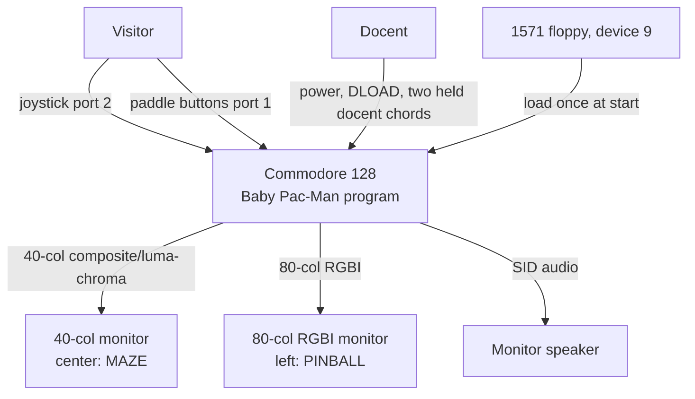
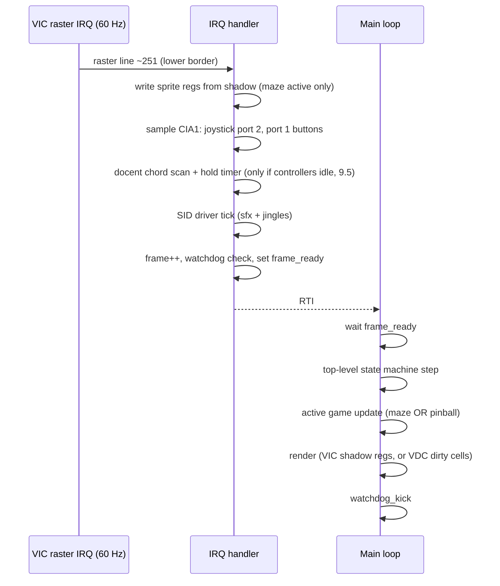
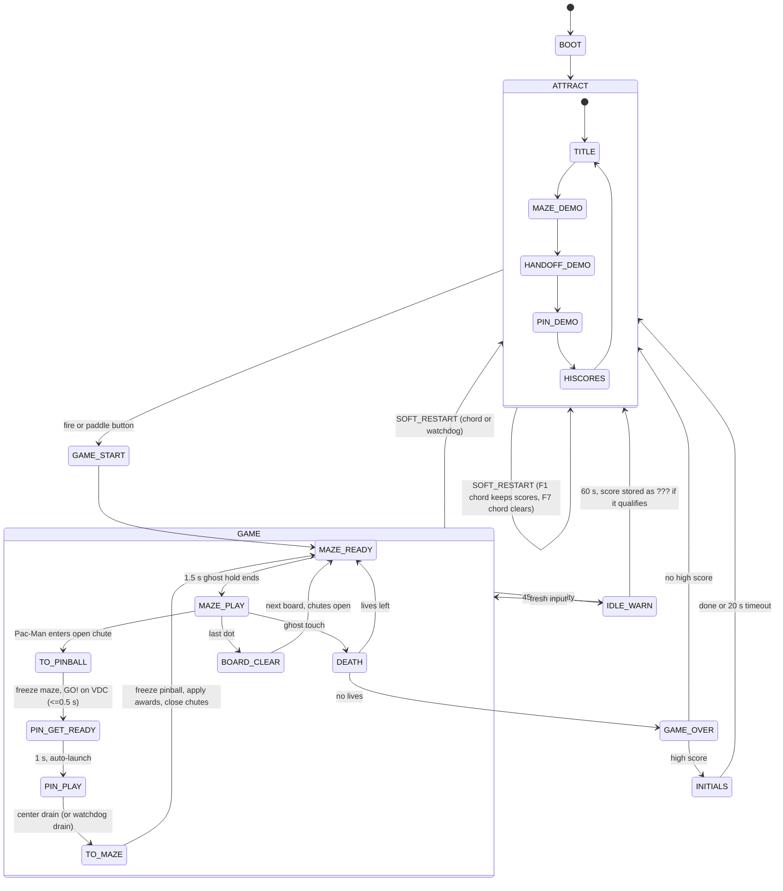

# Software Architecture: Baby Pac-Man for the Commodore 128

**Version:** 0.2 (draft, not reviewed)
**Last Updated:** 2026-10-27
**Author:** the maintainer DeMarco, with AI assistance (software-architecture agent)
**Status:** Draft
**PRD Reference:** `docs/PRD.md` v0.1.
**UX Reference:** `docs/ux-spec.md` v0.1. the maintainer decided (2026-10-27) to adopt the UX spec's docent recovery design. Where this document and the UX spec disagree on anything visitor- or docent-facing, the UX spec wins; Section 19 lists the places that still need to follow it.

**Confidence markers** (same as the PRD)
- **[Confirmed]**: stated by the project owners, marked confirmed in the PRD or brief, or checked by this agent on 2026-10-27 (noted where checked).
- **[Unconfirmed]**: from memory. Each one says how to verify it. Nothing marked [Unconfirmed] should be relied on in code until it is checked.
- **[Assumption An]**: PRD Section 8 defaults.

Many hardware facts in this document are from memory: C128 register numbers, bit layouts and timings. The first prototype (Section 14) is designed to check the risky ones before any game code depends on them.

---

## 1. Executive Summary

### 1.1 System overview
This is one 6502 (8502) machine-language program on a stock C128 in C128 mode. It drives both video chips at the same time:

- **VIC-IIe (40 columns, main screen):** the maze. It uses text mode with a custom charset for walls and dots, and hardware sprites for Pac-Man, the four ghosts and the fruit.
- **VDC 8563 (80 columns, left screen):** the pinball table. It uses text mode with a custom 512-glyph charset and per-cell RGBI color attributes. The ball and flippers are drawn in software by rewriting a few glyphs and screen codes each frame.

Only one game simulates at a time. The other is frozen: its state is held in RAM and its last image stays on its monitor, because both chips keep refreshing from their own memory without CPU help. One 60 Hz raster interrupt on the VIC drives timing, input sampling and sound. The main loop runs the active game's update.

The program takes over the machine: ROMs are banked out, all interrupts are its own, and it never returns to BASIC. It runs at **1 MHz** throughout, so the frozen 40-column maze stays visible (NFR-3).

### 1.2 Key architectural decisions
| # | Decision | Choice | Rationale |
|---|---|---|---|
| ADR-001 | Toolchain | **ca65/ld65 (cc65 2.19), all-assembly runtime**, GNU make, Python 3 asset tools, VICE `c1541` for disk images | Homebrew bottle on arm64 (checked), linker configs suit C128 memory layout, one-command reproducible build |
| ADR-002 | CPU speed | **1 MHz always**; 2 MHz border trick is an optional later optimization | 2 MHz garbles the VIC display, and the frozen maze must stay visible |
| ADR-003 | Pinball rendering | **VDC text mode, custom charset, software "glyph sprites"** for the ball; pre-drawn glyph frames for the flippers | Fits 16K VDC RAM; few bytes written per frame |
| ADR-004 | VDC access | **CPU writes through $D600/$D601 with a status poll on every access; no block copy or fill in the game** | R1 (block-op corruption on real hardware), NFR-9 |
| ADR-005 | Machine ownership | **ROMs banked out, own IRQ/NMI vectors in RAM, KERNAL not used after boot; RUN/STOP and RESTORE do nothing for anyone** | Cycle budget, deterministic timing, visitors cannot break out (FR-5.6, UX D10/C1) |
| ADR-006 | Delivery | **One PRG with a BASIC stub**, loaded with `DLOAD`, then `RUN`; `.d64` primary image, `.d71` and bare `.prg` too; optional device-8 boot sector | Matches the docents' routine (TR-4) |
| ADR-007 | Simulation | **Deterministic fixed-step simulation** (frame-count timers, seeded PRNG, integer math) | Freeze/resume is exact; input replay drives attract mode and regression tests |
| ADR-008 | VDC memory | **16K map** (Section 4.3); 64K is not used | A1; one map works on every model |

### 1.3 Technology stack
| Layer | Technology |
|---|---|
| Runtime | 8502 machine language, C128 mode, 1 MHz, no ROM calls after boot |
| Assembler / linker | ca65 + ld65 from cc65 2.19 (Homebrew `cc65`) |
| Build | GNU make (macOS `/usr/bin/make`), single target `make` |
| Asset tools | Python 3 scripts in `tools/` (maze map, table map, charsets, sprites, music data) |
| Disk images | VICE `c1541` (Homebrew `vice`), plus a Python boot-sector patcher |
| Emulator | VICE 3.10 `x128`, GTK3 UI (Homebrew formula uses `--enable-gtk3ui`, checked 2026-10-27), which shows the VIC and VDC in two windows |
| Acceptance | Real C128 + 1571 + RGBI monitor at the museum (or a borrowed machine, A12) |

---

## 2. System Context

### 2.1 Context diagram


### 2.2 External systems
| System | Purpose | Interface |
|---|---|---|
| 1571 drive (device 9, A7) | Loads the program once. Never written (NFR-8). | IEC fast serial via the KERNAL during load only |
| 40-column monitor | Maze display | VIC-IIe video output |
| 80-column monitor (A3: RGBI) | Pinball display | VDC RGBI output |
| Controllers | Joystick port 2, paddles port 1 (A5, A6) | CIA1 $DC00/$DC01 |

### 2.3 Actors
| Actor | Interactions |
|---|---|
| Visitor | Fire to start, joystick in the maze, paddle buttons in the pinball, initials entry |
| Docent | Load; docent chords (CTRL + C= + F1: soft restart keeping scores; CTRL + C= + F7: restart and clear scores; 9.5); hard recovery = power switch, or reset button and reload. RUN/STOP and RESTORE do nothing. |
| Developer / maintainer (post-handover: museum volunteer) | `make`, VICE, real-hardware test disk |

---

## 3. Toolchain (ADR-001)

### 3.1 Options considered
| Option | Pros | Cons |
|---|---|---|
| **A. ca65/ld65 (cc65), assembly only** | Homebrew bottle `cc65 2.19` for arm64 (checked 2026-10-27). Mature macro assembler. ld65 linker configs map segments to fixed C128 addresses, which suits banking and VIC-bank placement. VICE label export (`-Ln`). The cc65 tree has VDC driver code to read as a reference (`libsrc/c128/emd/c128-vdc.s`, and the C64 variant the PRD names). Large user base, well documented. | Linker config syntax takes some learning. Weaker compile-time scripting than KickAssembler, so asset generation moves to Python (that also makes it easier to test). |
| B. KickAssembler | Strong scripting (asset import, tables), widely used in the C64 demo scene | Not in Homebrew. The jar is a manual download, which hurts reproducibility. Java 21 is installed, but pinning versions is manual. Fewer people know it outside the demo scene, which matters for handover. |
| C. cc65 C + assembly | Faster to write menus and attract logic | The C runtime assumes KERNAL banking and its own zero page. Too slow for VDC rendering. Mixing it with a ROMs-out machine adds risk for little gain. |
| D. ACME / 64tass | Simple, in Homebrew (ACME 0.97) | No linker. Segment placement across the C128 map is manual. |

**Decision: A.** ca65/ld65, assembly only. Python 3 (system or Homebrew) for asset converters and test harnesses. GNU make drives everything.

**Handover argument:** a museum volunteer with a Mac or Linux box runs `brew install cc65 vice` (or the apt equivalents), then `make`. No jars, no IDE.

### 3.2 Build verification on this Mac
Checked 2026-10-27: Homebrew is at `/opt/homebrew`, the machine is arm64, `cc65` 2.19 and `vice` 3.10 are available as bottles (neither is installed yet), and Java 21 is present (only needed if we ever switch to option B).

Installing and running the toolchain is step P0 of the prototype (Section 14). The [Unconfirmed] items to check then:
- The Homebrew `vice` bottle includes the C128 ROM images (KERNAL, BASIC, chargen, and the 1571 drive ROM). **Verify:** `x128` boots to the BASIC 7.0 banner; a 1571 attached as drive 9 answers `DIRECTORY U9`.
- `x128` command-line options used in this document (`-ntsc`, `-drive9type 1571`, `-9 <image>`, `-keybuf`, `-moncommands`, `-VDC16K`/`-VDC64K`, `-warp`, `-limitcycles`, `-exitscreenshot`, `-debugcart`, `-binarymonitor`). **Verify:** `x128 -help > docs/notes/x128-help.txt`, then fix this document and the Makefile to match the real names.

### 3.3 Repository layout
```
Makefile                 one-command build: make (all), make run, make test, make disk
src/
  main.s                 boot, MMU setup, IRQ/NMI, main loop, top-level state machine
  config.inc             build settings: VIDEO=NTSC|PAL, VOLUME, DEBUG, FLIPPER_PORT, etc.
  hw/c128.inc            MMU, CIA, VIC, SID, VDC register equates
  vdc.s                  VDC access layer (Section 6)
  input.s                joystick, paddle buttons, docent chords, idle timer
  sound.s                SID driver, sfx and jingle data player
  maze/                  maze engine: map, actors, ghost AI, sprites, HUD
  pinball/               physics, flippers, collision, render, table logic, HUD
  attract.s              attract sequence, demo replay, high-score table, initials entry
  diag/vdctest.s         VDCTEST hardware diagnostic program (separate PRG)
  linker/bpm.cfg         ld65 memory map (Section 4)
assets/                  source art: maze.txt, table.txt, glyphs (PNG), sprites (PNG), music (text)
tools/                   Python: mkmaze.py, mktable.py, mkcharset.py, mksprites.py, mkboot.py, vice_harness.py
tests/                   replay files, expected hashes, VICE harness scripts
build/                   generated (gitignored): .o, .prg, .d64, .d71, .lbl, .map
docs/                    PRD, this document, UX, test plan, operating card
```

### 3.4 Build outputs (`make`)
| Artifact | Purpose |
|---|---|
| `build/babypacman.prg` | Main program (BASIC stub plus machine code) |
| `build/vdctest.prg` | Hardware diagnostic (V5, V6, model detection) |
| `build/babypacman.d64` | Primary disk image: `BABY PAC-MAN` and `VDCTEST`. Readable by 1541 and 1571. |
| `build/babypacman.d71` | The same files on a double-sided image, for anyone who prefers it |
| `build/babypacman-boot.d64` | Same as `.d64`, plus a C128 boot sector for device-8 autoboot (TR-6) |
| `build/babypacman.lbl`, `.map` | VICE labels and linker map, for debugging and the memory-budget check |

Images are made with `c1541 -format "baby pac-man,bp" d64 build/x.d64 -write build/babypacman.prg "baby pac-man" ...`. The `c1541` lowercase/PETSCII name conversion is [Unconfirmed]. **Verify:** in VICE, `DIRECTORY U9` shows exactly `"BABY PAC-MAN"`. The build is reproducible: no timestamps go into the PRG, and `make` twice gives identical bytes (checked by `make check-repro`).

---

## 4. Memory Architecture

### 4.1 C128 banking model (from memory, [Unconfirmed] in detail)
The MMU configuration register is at `$D500`, mirrored at `$FF00`, and the mirror is visible in every configuration. The bits as I recall them:
- bit 0: `$D000-$DFFF`, 0 = I/O, 1 = RAM/ROM
- bit 1: `$4000-$7FFF`, 0 = BASIC low ROM, 1 = RAM
- bits 2–3: `$8000-$BFFF`, 00 = BASIC high/monitor ROM, 11 = RAM
- bits 4–5: `$C000-$FFFF`, 00 = KERNAL/editor ROM, 11 = RAM
- bit 6: RAM bank 0 or 1

`$FF00 = $3E` means RAM bank 0 everywhere, with I/O visible at `$D000`. `$FF00-$FF04` are always MMU registers, so RAM there is unusable. The RAM configuration register `$D506` sets common RAM and which RAM bank the VIC sees.

**Verify:** C128 Programmer's Reference Guide (PRG), MMU chapter. In VICE, set `$FF00=$3E` from the monitor, then check that `$E000` reads RAM and `$D020` changes the border.

**Runtime configuration:** after boot the program sets `$FF00 = $3E` and stays there. It uses RAM bank 0 only. RAM bank 1 is not used (reserved for a v2 or two-player state).

### 4.2 Main RAM map (RAM bank 0, runtime)
| Range | Size | Use |
|---|---|---|
| `$0000-$00FF` | 256 | Zero page. `$00/$01` are the 8502 port. `$02-$7F` belong to the active game (ZP scratch is saved and restored on handoff; see 5.3). `$80-$FF` hold system state (IRQ, input, sound, VDC pointers). |
| `$0100-$01FF` | 256 | Stack |
| `$0200-$0FFF` | 3.5K | System RAM: game-state structs (maze, pinball, session), high-score table, sound state, input replay buffer. KERNAL areas here are free once the ROMs are out. |
| `$1000-$1BFF` | 3K | Pinball working buffers: a main-RAM shadow of the VDC screen codes (2000 bytes) for collision and restore, and a dirty list |
| `$1C01-$1C0F` | ~15 | BASIC stub `10 SYS 7184` (exact address set by the linker) |
| `$1C10-$3FFF` | ~9K | Code: boot, main loop, IRQ, input, sound, VDC layer |
| `$4000-$7FFF` | 16K | **VIC bank 1** (4.4) |
| `$8000-$CFFF` | 20K | Code (maze, pinball, attract) and data: pinball table master (screen + attributes, 4K), VDC charset source (512 glyphs × 8 bytes, 4K), multiply tables (2K), flipper geometry, music |
| `$D000-$DFFF` | 4K | I/O (VIC, SID, MMU, VDC at `$D600`, CIA1, CIA2, color RAM `$D800`) |
| `$E000-$FEFF` | ~8K | Spare: data unpacked at boot, debug HUD, growth room |
| `$FF00-$FF04` | 5 | MMU (not RAM) |
| `$FF05-$FFF9` | ~250 | IRQ/NMI trampolines |
| `$FFFA-$FFFF` | 6 | NMI, RESET, IRQ vectors in RAM (ROMs are out) |

**Load-image rule:** the PRG is one contiguous image from `$1C01` and must end at or below `$CFFF`. That keeps the KERNAL loader away from the I/O range; whether it can write RAM under I/O is [Unconfirmed] and avoided rather than tested. Anything meant for `$E000+` is stored inside the image and copied at boot. The linker config enforces this limit, and `make` fails if the image goes past it. Expected image size is 28–36K.

### 4.3 VDC RAM map (16K, ADR-008)
| VDC address | Size | Use |
|---|---|---|
| `$0000-$07CF` | 2000 | Screen codes, 80×25 |
| `$07D0-$07FF` | 48 | Unused |
| `$0800-$0FCF` | 2000 | Attributes, 80×25 (bits as I recall: 7 = alternate charset, 6 = reverse, 5 = underline, 4 = blink, 3–0 = RGBI) [Unconfirmed bit order] |
| `$1000-$17CF` | 2000 | Title / attract / high-score screen codes (second page, switched by display-start registers) |
| `$1800-$1FCF` | 2000 | Attributes for that page |
| `$2000-$2FFF` | 4096 | Charset 0: 256 glyphs × 16-byte stride (8 rows used) |
| `$3000-$3FFF` | 4096 | Charset 1 (alternate, chosen per cell by attribute bit 7): 256 glyphs |
| Total | 16,384 | Exactly 16K |

Notes:
- Two pages, not a double buffer for the table. The second page holds the title and high-score screens, so attract mode switches screens instantly by moving the display start (VDC R12/R13 screen, R20/R21 attributes) instead of redrawing 4,000 bytes. The table itself is updated in place with dirty cells (Section 8.5).
- 8-scanline cells. The VDC character cell can be taller (R9/R23) and the charset stride is 16 bytes either way. We keep the KERNAL default of 8 scanlines per row and 25 rows, so the monitor timing does not change (V3 risk).
- On a 64K VDC (DCR), this map sits in the first 16K and runs unchanged. The program never changes the RAM-type bit (R28 bit 4) [Unconfirmed bit position]. It reads R28 and changes only the charset-base bits.
- The VDC charset base is R28 bits 7–5, in 8K steps (as I recall). `$2000` is the KERNAL default, so we only overwrite the glyph data [Unconfirmed]. **Verify** in the P1 hello-world by reading R28 at boot and printing it on the debug line.

### 4.4 VIC bank 1 map (`$4000-$7FFF` in RAM bank 0)
CIA2 `$DD00` bits 1–0 select VIC bank 1, and the VIC sees RAM bank 0 (`$D506` bit 6 = 0) [Unconfirmed bit]. Bank 1 is chosen because the character ROM image appears to the VIC in banks 0 and 2 on the C64. On the C128 this is also governed by the 8502 port `$01` [Unconfirmed]. Bank 1 sidesteps the question. **Verify:** P1 shows custom glyphs, not ROM characters.

| Range | Use |
|---|---|
| `$4000-$43E7` | Maze screen matrix (40×25) |
| `$43F8-$43FF` | Sprite pointers |
| `$4400-$47FF` | Second screen matrix (title, attract, initials), switched with `$D018` |
| `$4800-$4FFF` | Maze charset (256 × 8): walls (autotiled), dots, chute gates, energizer, font, side-panel art |
| `$5000-$5FFF` | Sprite data, 64 × 64 bytes: Pac-Man 4 directions × 3 frames, death animation, ghost bodies 2 frames, eyes 4 directions, frightened 2 frames, fruit set, score popups |
| `$6000-$7FFF` | Code/data overflow (the VIC does not read it) |
| `$D800-$DBE7` | Color RAM (fixed address). The C128 has two color-RAM banks selected through the 8502 port [Unconfirmed]; we use whichever is active at boot and never switch. |

---

## 5. Runtime Architecture

### 5.1 Boot sequence
1. `RUN` executes the BASIC stub, which runs `SYS` to the entry point.
2. `SEI`. Set `$FF00=$3E`. Write the NMI, RESET and IRQ vectors at `$FFFA-$FFFF` (RAM). The NMI vector points at a bare `RTI` (5.2).
3. Silence the CIAs: `$DC0D=$7F` and `$DD0D=$7F`, then read both to acknowledge. Disable VIC interrupts, set `$D030=0` (1 MHz; bit 0 = 2 MHz) [Unconfirmed bit], clear the SID.
4. **Video standard check:** measure the VIC's last raster line (262 or 263 on NTSC, 311 on PAL). If it does not match the build's `VIDEO` setting, show an error on both screens ("PAL MACHINE: USE PAL DISK") and stop. This follows the no-demo-fallback rule.
5. **VDC presence check (UX 11.2, C9):** poll the VDC status ready bit with the bounded timeout from 6.2. If the VDC never reports ready, the VIC screen shows `80-COLUMN SCREEN NOT RESPONDING - SEE OPERATING CARD` and the program stops there (IRQ off, no game, no VIC-only mode). This replaces PRD 6.5's "the game still runs": the chutes need the pinball. A missing monitor or cable cannot be detected from software; the card covers it. [Unconfirmed: that a missing or dead 8563 reads as "never ready" rather than as a stuck-ready status. Check in VICE if it can disable the VDC, otherwise from the PRG.]
6. **VDC init:** set only the registers we rely on: display start, attribute start, attribute enable (R25 bit 6), global background color (R26), charset base (R28 bits 7–5, read-modify-write). Do not touch the horizontal and vertical timing registers (R0–R8) that the KERNAL set for the attached monitor. Upload charsets (2 × 256 glyphs, expanded from 8 to 16 bytes per glyph with 8 bytes of padding skipped), then the table page and the title page. This takes about 12K VDC writes, roughly 0.3 s (to be measured in P2).
7. **VIC init:** select bank 1, screen `$4000`, charset `$4800`, sprites at `$5000`, colors.
8. Set up the raster IRQ (line about 251, NTSC lower border), `CLI`.
9. Enter the top-level state machine in `ATTRACT`.

The RESET vector in RAM is not used, because a hardware reset maps the ROMs back in. **Hard recovery is the power switch, or the reset button followed by a reload**: both return to BASIC and the docent loads again (UX 11.2, step 2). The card leads with the power switch, because where the reset button sits depends on the model [Unconfirmed, UX UV9].

### 5.2 Frame structure


- **Single IRQ per frame** in the lower border. The maze updates sprite registers from a shadow copy there, so there is no tearing. Sprites never pass the IRQ line because the maze is inside the display area.
- **The main loop is fixed-step.** If an update overruns a frame, the next frame runs immediately (catch-up of at most 1 frame, then frames are dropped). Timers count frames, never wall time, so freeze needs no special handling.
- **Frame watchdog:** the IRQ counts frames since the main loop last called `watchdog_kick`. After 120 frames (2 s), the IRQ resets the stack pointer, puts a soft-restart address on the stack and returns into **SOFT_RESTART**: re-init the VDC and VIC, keep high scores, go to `ATTRACT`. Any internal hang becomes a 2-second hiccup back to attract mode (PRD 6.5, NFR-5). This is the UX 11.2 "self-recovery" proposal, confirmed feasible. A fault counter in RAM is shown on the debug HUD and read by soak tests.
- **SOFT_RESTART** has one entry and one flag, `clear_scores`. The watchdog, a VDC fault (6.2) and the CTRL + C= + F1 chord enter with `clear_scores = 0`. The CTRL + C= + F7 chord enters with `clear_scores = 1`, which reloads the default high-score table first (9.5). Every entry re-runs the VDC presence check (5.1 step 5), so a VDC that dies during the day ends in the error screen, not a restart loop. On the way into `ATTRACT` the VDC screen and attributes are fully redrawn from the main-RAM master (UX 12.5 soft-corruption scrub).
- **If the raster IRQ itself is dead**, neither the watchdog nor the chords can run, because both live in the IRQ. The only recovery is the power switch (or reset and reload), as UX 11.2 states and as the card's step 2 says.
- **NMI (RESTORE key): ignored.** The NMI vector points at a bare `RTI`; the handler touches no register and no memory. CIA2 interrupt sources are disabled at boot (`$DD0D=$7F`), so RESTORE is the only expected NMI source. RESTORE does nothing for anyone, visitor or docent (UX D10, C1). [Unconfirmed: that RESTORE on the C128 reaches the 8502 only as an NMI, as on the C64, and that a bare `RTI` handler is the whole job. Verify in P1: press RESTORE and RUN/STOP + RESTORE repeatedly in VICE, then on hardware (UX UV10). Fallback named in UX 12.4: RESTORE re-enters the program's own start.] Before the program's vectors are installed (during `DLOAD`, and the few instructions before `SEI`), the KERNAL still handles RESTORE; that window is before the game exists and needs nothing.
- **RUN/STOP: no function.** The KERNAL keyboard scan never runs after boot, and the program's own scan (9.5) reads only the four chord keys. RUN/STOP is never read.

### 5.3 Top-level state machine


**Freeze/resume design (FR-4.1 to FR-4.4):**
- Each game owns a state struct in `$0200-$0FFF`: positions, directions, mode timers, PRNG state and awards. Each game also owns zero page `$02-$7F` while it is active. On handoff, the outgoing game's ZP block is copied to its struct and the incoming game's block is restored, which costs about 2 × 126 bytes, roughly 2,000 cycles. "Frozen" means the update routine is not called. No timer, sprite or sound advances, because they all live in that update.
- **Displays stay up without CPU work.** The VIC keeps showing the screen and sprite registers last written. The VDC keeps showing its RAM. Nothing is blanked (FR-1.2).
- **Paused cues:** on freeze, the outgoing game draws its paused cue and dims itself. Copy, colors and timings follow UX 6.2 and 8.1/8.2: VIC row 24 `<< PINBALL IS ON THE LEFT SCREEN`; VDC right panel `MAZE IS PAUSED` / `MAZE ON CENTER SCREEN >>`. For the maze, color RAM is rewritten to the UX paused palette (walls light blue to blue, dots light gray to dark gray, border dark gray), about 1,000 color-RAM writes plus the border register. **Sprite colors are not changed on pause** (UX 4.3). For the pinball, the banner is drawn, and the full attribute dim is optional because it costs about 2,000 VDC writes, roughly 40 ms, which is still within the 0.5 s handoff limit. Any blinking cue is driven from the IRQ frame counter (a color toggle), so the frozen game still does no simulation work. Nothing flashes faster than 2 Hz (UX 6.3).
- **Resume (maze, UX 8.2)** restores colors, removes the paused cue, flashes `G O !` on row 24 for 60 frames and **flashes the VIC border white at 2 Hz for the same second** (`$D020` toggled from the IRQ). Then the **ghost hold** (FR-4.4 as revised by UX C3): for 90 frames the ghosts do not move and cannot hurt Pac-Man, and their sprite colors alternate between body color and white at 2 Hz (toggle every 15 frames, 4 register writes). **No "READY" text** is drawn. Pac-Man is controllable from the first frame [UX proposal; open as UX U2].
- **Awards transfer** (FR-3.6, FR-4.5) goes through a small `awards` struct written by the pinball and consumed by `TO_MAZE`. It is the only data that crosses between the two games.

### 5.4 CPU budget at 1 MHz (NTSC, A4)
| Item | Cycles per frame |
|---|---|
| Frame: 263 lines × 65 cycles [Unconfirmed for the C128 VIC-IIe NTSC; verify with a CIA timer in P2] | 17,095 |
| VIC bad lines (25 × ~40) | −1,000 |
| Sprite DMA, 6 sprites × 21 lines × ~2–3 | −300 |
| IRQ: input, docent chord scan (~60), SID driver, watchdog, sprite shadow copy | −1,200 |
| **Available to the active game** | **~14,500** |

PAL: 312 × 63 = 19,656 per 50 Hz frame. All speed constants come from `config.inc` tables per `VIDEO` (A4: PAL-ready).

Budget targets: maze update + render ≤ 6,000 (plenty). Pinball physics ≤ 6,000, VDC render ≤ 5,000, with ~3,000 headroom. If pinball misses 60 Hz, the fallback is physics at 60 Hz with VDC render every other frame (30 Hz render, NFR-2 minimum), selected by a build flag.

**2 MHz (ADR-002):** switching to 2 MHz only while the VIC beam is in the vertical border would give roughly +3,500 cycles per frame. This is not in the baseline. I recall that I/O accesses (VIC, SID, CIA) are stretched to 1 MHz at 2 MHz, and that VDC throughput is limited by the VDC itself, so the gain for VDC rendering may be small [Unconfirmed]. It is considered only if V1 fails, and only after a hardware check that the VIC display stays clean (R4).

---

## 6. VDC Access Layer (`src/vdc.s`, ADR-004)

### 6.1 Register interface [Unconfirmed register numbers; verify against the C128 PRG 8563 chapter and cc65 `c128-vdc.s`]
- `$D600` write: register select. `$D600` read: status, as I recall: bit 7 = ready (the last access is done), bit 6 = light pen, bit 5 = vertical blank, bits 2–0 = chip version.
- `$D601`: data for the selected register.
- R18/R19: update address high/low. R31: data. Each R31 access auto-increments the update address.
- R30: word count (block ops). R24 bit 7: copy/fill select. R32/R33: block-copy source. **Not used in the game.**
- R12/R13: display start. R20/R21: attribute start. R25: mode (bit 7 bitmap, bit 6 attributes on). R26: foreground/background color. R28: charset base / RAM type.

### 6.2 Primitives
All primitives poll status bit 7 before **every** register select and data access (NFR-9). Each poll has a bounded timeout.

```
vdc_wait:   ldy #0           ; ~256 polls, about 2.3 ms worst case
@l:         bit $D600
            bmi @ok
            dey
            bne @l
            jmp vdc_fault    ; sets fault flag, SOFT_RESTART (re-checks the VDC, 5.2)
@ok:        rts              ; (inlined via macro in hot paths, no jsr)
```

| Routine | Use | Estimated cost (to be measured in P2) |
|---|---|---|
| `vdc_setaddr` (R18, R19, select R31) | Start of any run | ~45–55 cycles |
| `vdc_put` (poll + store) | Next byte in a run | ~14–20 cycles/byte in an unrolled or indexed loop |
| `vdc_poke(addr, val)` | Single cell | ~70 cycles |
| `vdc_run(addr, src, n)` | Glyph rows, flipper rows, text | setaddr + n × put |
| `vdc_fill_cpu(addr, val, n)` | Boot and screen clears | CPU loop, no block fill |
| `vdc_peek` | Diagnostics only | read R31 after setaddr |

The game never reads VDC RAM during play. A main-RAM shadow of the table screen codes is the source of truth for collision and restore.

### 6.3 Per-frame write budget (pinball active, worst case)
| Work | Writes | Cycles (est.) |
|---|---|---|
| Ball: 4 composited glyphs × 8 rows | 4 runs × 8 | ~4 × (50 + 8 × 18) ≈ 780 |
| Ball: new cell codes (≤4) + restore old (≤4) | ≤8 pokes | ≤560 |
| Flippers: only on angle change, 2 flippers × ~3 rows × 6–7 cells | 6 runs | ~1,100 |
| Score / tally digits (changed only) | ~10 | ~300 |
| Banner blink, target lamps (changed only) | ~10 | ~300 |
| **Worst case** | | **~3,000** of the ~5,000 budget |

If P2 shows the VDC is much slower than this, for example because the busy flag stays clear for long periods during display fetch, the mitigations in order are:
1. Glyph composition limited to the rows the ball covers (4 rows instead of 8).
2. Flipper frames reduced from 4 to 3.
3. 30 Hz render with 60 Hz physics.
4. Schedule bulk writes in VDC vertical blank (status bit 5).

### 6.4 Tearing control
- **Ball:** two sets of 4 ball glyph slots (A/B) in each charset. Frame N composes into the unused set (invisible), then swaps 4–8 screen codes in one burst (~500 cycles, about 8 VDC scanlines). A tear can only show a ball cell half old/half new for one frame, and only if the VDC beam crosses those two cell rows during that burst. V1 checks this visually in VICE frame-step and on hardware. If it is visible, commit the burst during VDC vertical blank (poll bit 5, with a bounded wait).
- **Flippers:** frames are pre-drawn glyph blocks. Changing angle rewrites screen codes only, so no glyph data changes while it is displayed.

---

## 7. VIC Maze Engine (`src/maze/`)

### 7.1 Display
- Hi-res text mode (not multicolor), black background, custom charset at `$4800`.
- **Redrawn maze, per UX 4.1/4.4 and Section 5 (supersedes the 28 × 25 layout of v0.1):** 38 × 21 cells at screen columns 1–38, rows 2–22. Rows 0–1 are the HUD, row 23 holds the chute arrows, row 24 is the message row. Columns 0 and 39 stay empty. The two chutes are mouths in the bottom wall (row 22) at columns 5 and 34. The tunnel is on row 12. Closed chutes are drawn as a gate glyph in a different color (NFR-11: shape plus color). The ghost house, at least one side tunnel (if UX can fit it) and the four energizer corner positions are kept. **The layout is owned by UX design.** Architecture fixes the format: `assets/maze.txt` (ASCII, one char per tile) → `tools/mkmaze.py` → screen codes (walls autotiled into the right glyphs), a per-tile attribute byte (wall, dot, energizer slot, chute L/R, tunnel, ghost-house door, no-up zones), a junction table and the dot count.
- 8×8 tiles. Actors move on tile centers; sprites are drawn as 12–13 px shapes centered on the tile. The 9-bit sprite X uses `$D010`, because the right part of the maze puts sprites past x = 255.

### 7.2 Sprites
| Sprite | Use | Notes |
|---|---|---|
| 0 | Pac-Man | Yellow, 3-frame chomp × 4 directions, death animation |
| 1–4 | Ghosts | Red, pink (VIC light red), cyan, orange (VIC orange); frightened blue/white; eyes-only when eaten. Ghost eyes are part of the single-color sprite shape (no overlay sprites), to keep 6 sprites total. |
| 5 | Fruit / score popup | |
| 6–7 | Spare | Chute "GO" arrow, or overlay eyes if UX insists on two-color ghosts |

No multiplexing (6 sprites ≤ 8) and no flicker (PRD 3.2 acceptance). Collisions are tile-based in software, not from VIC hardware collision registers.

### 7.3 Movement and AI
- Positions are tile coordinates plus a sub-tile pixel offset (0–7) and a fractional speed accumulator (8.8 fixed point), so speeds such as "80% of max" are exact per frame. Speed tables are per board and per mode, NTSC and PAL variants.
- Turn buffering (FR-5.1): the last joystick direction pressed is held as `want_dir` for 8 frames and applied at the next tile center where it is legal. Pre-turns at corners happen at the tile center only (simple, deterministic).
- **Ghost AI:** the classic target-tile method. At each tile center a ghost picks the legal non-reverse direction that minimizes squared distance to its target. Targets: Blinky = Pac-Man's tile; Pinky = 4 tiles ahead; Inky = the reflected vector from Blinky through 2 ahead; Clyde = Pac-Man's tile when farther than 8 tiles, else his scatter corner. Modes follow a scatter/chase timer table per board. Frightened mode picks directions from the PRNG. Eaten ghosts target the house door. Forced reversal on mode change. The cost is about 300 cycles per ghost decision, only at tile centers. This reproduces the feel and is not ROM-exact (PRD non-goal).
- **PRNG:** a 16-bit LFSR, seeded at game start from the frame counter in attract (visible play varies). In demo or replay mode it is seeded from the replay file (deterministic, ADR-007).
- **Chute entry:** when Pac-Man reaches a chute tile center moving down and chutes are open, `TO_PINBALL` is triggered and the chute ID is stored for resume placement (FR-4.4). A closed chute tile is a wall.

---

## 8. Pinball Engine (`src/pinball/`)

### 8.1 Layout and coordinates
- The table band is 40 columns × 25 rows centered on the VDC screen (columns 20–59), which is 320 × 200 VDC pixels (PRD 6.4). Side panels are columns 0–19 and 60–79, with critical text kept at least 4 columns from each edge (V3 overscan).
- **Physics space:** square units. The VDC pixel is about twice as tall as it is wide (PRD 6.4; the exact ratio is V2). Physics runs in units of one VDC pixel width; one VDC scanline = `ASPECT_Y` units (default 2, build constant). The table is 320 × 400 units. Position is 16-bit with 4 fraction bits (x up to 5,120, y up to 6,400 in 1/16 units). Velocity is signed 16-bit in 1/16 units per substep.
- Render conversion: `px = x >> 4`, `scanline = (y >> 4) / ASPECT_Y`. With ASPECT_Y = 2 this is a shift.

### 8.2 Physics model ("believable, not simulated", FR-3.4)
- 60 Hz frames, **2 substeps per frame**. Speed is clamped to |v| ≤ 3.5 px per substep on each axis, so the ball can never cross a full 8-pixel cell in one substep. Walls are at least one cell thick, which prevents tunneling (FR-3.4).
- Gravity: a constant added to vy per substep (tuned so a drop from the top to the flippers takes about 1.2 s).
- **Collision map:** each table glyph has a 1-byte collision class in a 512-byte table (indexed by glyph number plus alternate bit): empty, solid, slope / or \ (with stored normal), round bumper, target ID, drain, chute entry, flipper zone. The ball is a ~6 × 3 scanline shape (6 × 6 units). It probes up to 4 leading points per substep against the main-RAM screen-code shadow (no VDC reads).
- **Response:** v' = v − (1+e)(v·n)n, with n from a 16-direction unit-normal table and per-class restitution e (walls 0.6, bumpers 1.1 plus a kick). The multiply uses quarter-square tables (2 × 512 bytes), about 40 cycles per 8×8 multiply.
- **Watchdog for a stuck ball (FR-3.7):** a counter resets on any scoring hit or flipper contact. At 600 frames (10 s) it gives a nudge (random impulse); after 3 nudges it forces a drain.
- Estimated cost per substep: integrate ~80, probes ~400, response ~500 (when hitting), flipper checks ~2 × 400 → about 1,800. Two substeps ≈ 3,600, within the ~6,000 target.

### 8.3 Flipper model
- Each flipper is a line segment of length L (about 48 px) pivoting at a fixed point, with **4 discrete angles** (rest −30°, −10°, +10°, up +30°; values to tune). The same angles are used for rendering (8.5), so what the player sees is what the physics uses.
- Button pressed: rest to up in **2 frames** (about 33 ms; two angle steps in the first frame, one in the second). Released: up to rest in **3 frames**, one step per frame. This follows UX 7.5 and replaces v0.1's 3-frame rise and 2-frames-per-step fall; the swept-angle check below must cover a two-step sweep. The press is sampled in the IRQ, and the first angle step happens in the same frame's update, which meets S5 (≤ 1 frame).
- **Collision:** per flipper, the ball center is transformed into flipper-local coordinates with sin/cos tables for the 4 angles. The ball is checked against a capsule (segment plus radius). If it penetrates, it is pushed out along the normal and its velocity reflected with e = 0.3 (dead flipper). **If the flipper is moving up this frame**, the surface velocity ω × r is added, where r is the contact distance from the pivot (from the local coordinates). That gives the "where it hits and whether it is moving" behavior of FR-3.4. Shots off the tip are stronger.
- **Swept-angle check:** when the flipper moves between angles and the ball lies inside the swept wedge, the ball is placed on the new surface and given the impulse. This stops the flipper from passing through the ball.
- **Geometry (UX 7.2, C5):** funnel walls narrow the playfield from 38 cells at table row 13 to 18 cells at row 21. Flipper pivots sit at table columns 11 and 28 on row 21, and each flipper is **7 cells** long (L about 56 px, not 48). There are no outlanes: the funnel wall leads straight to the flipper.
- **Drain:** a **4-cell** gap at table columns 18–21, row 22, leading to a drain pit (rows 23–24). The width is a build constant `DRAIN_CELLS` (3, 4 or 5; default 4), set at the M2/M3 playtests. The gap has collision class `drain`. When the ball center enters it below the flipper pivots, `TO_MAZE` is triggered. There are no outlanes (FR-3.1), so this is the only exit (FR-3.5).
- Auto-launch (FR-3.2): after the 1 s GET READY, the ball appears in the top chute mouth (table columns 5–7 or 32–34, row 1) matching the maze chute used (UX-5, UX C8; launch at 1.3 s) with a downward/sideways velocity plus small PRNG variation.

### 8.4 Table features (FR-3.6)
Feature cells (targets, bumpers, spinner lane) are regions of glyphs with class IDs. A hit:
1. updates the `awards` struct or score;
2. queues a lamp change: a VDC attribute or screen-code rewrite of a few cells, through the dirty list;
3. queues a sound effect.

The feature set and placement follow UX design after the M2 review (Q14).

### 8.5 Rendering ("glyph sprites", ADR-003)
- **Table:** static glyphs in charset 0 (art and font) and charset 1 (flipper frames and extra art). The table master (screen codes and attributes) is in main RAM and uploaded at boot.
- **Ball:** a 6 × 3-scanline ball spans at most 2 × 2 cells. Each frame:
  1. Find the ≤4 covered cells.
  2. For each, take the underlying glyph bitmap from the main-RAM charset source.
  3. OR in the ball shifted by (x mod 8, scanline mod 8). The shifted-ball tables are 8 x-shifts × 2 rows of bytes, about 64 bytes.
  4. Write the result to a free ball slot in the same charset the cell uses (by its alternate bit). That way the attribute never changes, so there are no attribute writes and the ball takes the cell's color (UX-4).
  5. Point the cell at the slot. Restore the cells the ball left from the shadow.
- **Slots:** 2 sets × 4 slots in each charset = 16 glyphs reserved.
- **Flippers:** 4 angle frames per flipper, pre-drawn in charset 1. The right flipper is a mirror, so its glyphs are separate. Estimated frames are about 3 rows × 7 cells, with about 12 unique glyphs each → 4 × 2 × 12 ≈ 96 glyphs. The ball over a flipper composites on that flipper glyph, using the same method.
- **Glyph budget (V4):**

| Use | Glyphs |
|---|---|
| Font (bold, 2-px strokes, NFR-12): A–Z, 0–9, punctuation | ~48 |
| Table art: walls, slopes, bumpers, targets ×2 states, lanes, chute art, energizer and fruit icons, side-panel frame | ~140 |
| Ball slots (charset 0) | 8 |
| **Charset 0 total** | **~196 / 256** |
| Flipper frames | ~96 |
| Ball slots (charset 1) | 8 |
| Big-score digits / title logo pieces | ~100 |
| **Charset 1 total** | **~204 / 256** |

`tools/mkcharset.py` fails the build if either set goes over 256, which makes V4 a build-time check.

---

## 9. Input (`src/input.s`)

### 9.1 Ports [Unconfirmed bit details; verify in the C128 PRG CIA chapter and in VICE]
- **Joystick, port 2:** CIA1 port A `$DC00`, bits 0–4 = up, down, left, right, fire, active low.
- **Paddle buttons, port 1:** CIA1 port B `$DC01`. Paddle X fire = bit 2 (the "left" line, DB9 pin 3), paddle Y fire = bit 3 (the "right" line, DB9 pin 4). Which physical paddle is X (left flipper) is verified on hardware, and a build setting can swap them.
- The paddle pots (SID `$D419/$D41A`) are not read, so the CIA1 port A bits 6–7 paddle-select lines are irrelevant.

### 9.2 Sampling and keyboard interplay (FR-5.7)
In the IRQ each frame:
1. Set `$DC00 = $FF` (no keyboard column selected).
2. Read `$DC01`: port 1 alone (paddle buttons).
3. Read `$DC00`: port 2 alone (joystick).

Both are stored, along with edge flags. This makes the readings independent of keyboard state.

The **keyboard is scanned only for the docent chords** (9.5), and only when steps 2–3 show no port 1 or port 2 line active. Otherwise controller lines alias as key presses: the paddle fire lines are `$DC01` bits 2 and 3, which are the CTRL and F7 rows, so a held flipper would look like half a chord. The chord scan selects only the two needed columns.

### 9.3 Mapping
| State | Input |
|---|---|
| Maze | Joystick port 2 directions |
| Pinball | Port 1 bit 2 → left flipper, bit 3 → right flipper. **Fallback (FR-5.4):** joystick port 2 left/right also flip. Port 1 left/right on a joystick or a two-button DB9 box map to the same bits, so the A5 button box works with no code change. |
| Attract → start | Joystick fire, or either paddle button (FR-5.5) |
| Initials | Joystick up/down to change a letter, fire to confirm |

### 9.4 Idle timeout (FR-6.5, UX 12.1, C11)
- **Activity** is a change of state on any port 1 or port 2 line (a press or a release edge). A line that holds its state is not activity. A line held active for more than 300 frames (5 s; 250 PAL) is flagged `stuck` (shown on the debug HUD, used by 9.5). This implements the UX rule "an input held unchanged for more than 5 s is not activity": with edge-based activity a held input never counts, and the 5 s flag names the stuck case for code and tests. Starting a game uses press edges only, so a stuck fire button cannot restart games either (UX 10.3).
- The keyboard is never activity. A docent chord does not reset `idle_frames`.
- `idle_frames` (16-bit) resets on activity. At **2,700 frames (45 s; 2,250 PAL)** both screens show `STILL THERE? PRESS A BUTTON  nn`, flashing at 1 Hz, `nn` counting 15 down to 1 (VIC row 24; VDC right panel bottom). The game keeps running, including a pinball ball in play. The last 5 s add the idle tick sound. Any activity clears the warning and resets the timer.
- At **3,600 frames (60 s; 3,000 PAL)** the game is abandoned and returns to `ATTRACT`. No initials prompt.
- **Abandoned qualifying score: resolved, stored with the initials `???`** (UX 9.4). Chosen as the simplest option: it reuses the normal high-score insert with a constant initials string and adds no state and no prompt.
- Attract mode never times out (UX 12.1).

### 9.5 Docent chords (FR-7.2 as revised by UX 11.1, C2)
**Resolved:** two chords, each held for 2 s, both working in attract and in play.

| Chord | Result |
|---|---|
| **CTRL + C= + F1**, held 2 s | `SOFT_RESTART` with `clear_scores = 0`: back to the title/attract, high scores kept |
| **CTRL + C= + F7**, held 2 s | `SOFT_RESTART` with `clear_scores = 1`: as above, and the high-score table is reset to the default names |

RUN/STOP and RESTORE are not part of any docent action (5.2). Hard recovery is the power switch, or the reset button and a reload (5.1).

**Matrix positions** (C64-compatible main matrix) [Unconfirmed: verify against the C128 PRG keyboard table and in VICE at P1]:

| Key | Column select (`$DC00` write) | Row read (`$DC01` bit, active low) |
|---|---|---|
| CTRL | `$7F` (PA7) | 2 |
| C= | `$7F` (PA7) | 5 |
| F1 | `$FE` (PA0) | 4 |
| F7 | `$FE` (PA0) | 3 |

Neither chord forms three corners of a matrix rectangle, so neither should ghost [Unconfirmed; UX UV8 tests it on the real keyboard]. The C128-only keys (keypad, ESC, HELP, ALT, the `$D02F` extra columns) are avoided.

**Scan, in the raster IRQ, after the controller sample (9.2):**
1. **Gate.** If any port 1 or port 2 line is active this frame, skip the scan and set `chord_frames = 0`. Paddle fire lines share `$DC01` bits 2 and 3 with the CTRL and F7 rows, and joystick lines share `$DC00` with the column selects, so no key read can be trusted while a controller is active.
2. **Read.** `$DC00 = $7F`, read `$DC01` for CTRL and C=. `$DC00 = $FE`, read `$DC01` for F1 and F7. Restore `$DC00 = $FF`. CIA1 port A is all-output and port B all-input, set at boot [Unconfirmed defaults]. About 60 cycles.
3. **Decode.** `SOFT` = CTRL and C= and F1 and not F7. `CLEAR` = CTRL and C= and F7 and not F1. Anything else is none.
4. **Hold timer.** If the decoded chord differs from the previous frame's, `chord_frames = 0`. If it is `SOFT` or `CLEAR` and `chord_armed` is set, `chord_frames++`. While `chord_frames > 0` the IRQ sets `docent_msg`, and the main loop shows `DOCENT RESTART IN 2...1...` on both screens (VIC row 24; VDC right panel bottom), above the idle warning in message priority. Releasing early cancels: `chord_frames = 0` and the previous message returns.
5. **Fire.** At **120 frames (2 s; 100 PAL)**, clear `chord_armed` and take `SOFT_RESTART` through the same stack-reset path as the watchdog (5.2), with `clear_scores` from the chord. The IRQ does this itself, so a main loop that is wedged but still kicking the watchdog is recovered too.
6. **Re-arm.** `chord_armed` is set again only after a frame in which none of the four chord keys is down, so a docent still holding the keys after the restart does not trigger a second one.

**Interaction with the idle and stuck-input rules (9.4):**
- The chords are not activity, and the idle timer does not cancel a chord in progress. If the 60 s abandon happens while a chord is held, the chord still completes and lands on the same attract screen.
- A **stuck controller line** (held active; flagged `stuck` after 5 s) keeps the gate in step 1 closed, so **no chord can be read while a button or joystick is stuck**. This is deliberate. A stuck paddle line makes CTRL or F7 look permanently pressed, so masking it would give either a false chord or an unreadable one. The docent lets go of or unplugs the controller, or uses the power switch (card step 2). See 12.6 for the card wording.
- A visitor cannot fire a chord while playing, because any controller input closes the gate and resets the timer.

---

## 10. Audio (`src/sound.s`)
- A custom SID driver ticks in the IRQ at 60 Hz. Voice allocation: voice 1 = maze effects (waka, eat ghost, fruit) or pinball effects (flipper, bumper, target); voice 2 = second effect layer (siren / ball roll); voice 3 = jingles and transition sounds. A priority scheme decides which effect a voice plays.
- Data format: compact command streams (note, duration, waveform, ADSR, sweep) assembled from `assets/music/*.txt` by a Python tool. Jingles are original compositions in the spirit of the arcade (PRD 2.1), not transcriptions.
- The SID filter is not used. The 6581 and 8580 filters differ a lot, and which SID the museum machine has is [Unconfirmed]: commonly 6581 in the flat C128 and 8580 in the DCR, from memory. No digi tricks are used, since volume-register sample playback behaves differently on the 8580.
- Master volume = build constant `VOLUME` in `config.inc` (FR-7.4, Q11).
- **On freeze:** the outgoing game's voices are gated off. Voice 3 plays the transition sound. Attract mode runs quieter (build constant `ATTRACT_VOLUME`, default about 1/2) so an unattended exhibit is not loud all day.

---

## 11. Attract Mode (`src/attract.s`)
- **Maze demo:** input replay (ADR-007). A developer-recorded input stream (direction changes with frame deltas, about 2–4 bytes per change) is replayed into the real maze engine with a fixed PRNG seed. The result is identical every time, uses no extra AI code, and doubles as a regression test. The script is recorded to reach a chute.
- **Pinball demo (HANDOFF_DEMO → PIN_DEMO):** the real handoff path runs, then a **flipper bot** flips when the ball is in a flipper's zone and moving down. After 20 s the bot stops flipping so the ball drains.
- The demo is clearly labeled: "DEMO — PRESS FIRE TO PLAY" on both screens (no-demo-fallback rule, PRD 6.5).
- The title and high-score pages use the second VIC screen matrix and the second VDC page. Switching is a register change.
- Input during attract: fire or a paddle button starts a game from any attract sub-state. The maze is re-initialized from scratch, so attract state never leaks into a game.

---

## 12. Build, Packaging and Delivery

### 12.1 PRG structure (ADR-006)
- BASIC stub at `$1C01`: `10 SYS 7184` (the address comes from the linker symbol). The PRG load address is `$1C01`.
- `DLOAD` loads relative to BASIC start. After power-on, BASIC text starts at `$1C01`. **If a `GRAPHIC` command had allocated the bitmap, BASIC start moves to `$4001`** [Unconfirmed], and the image would load to the wrong place.
- Mitigation: the docent procedure starts from power-on (the card says so). The entry code also checks TXTTAB (`$2D/$2E` [Unconfirmed address on C128]). If it is not `$1C01`, it prints "POWER OFF, ON, AND LOAD AGAIN" through the KERNAL and returns to BASIC. This is an honest error, not a broken game. Self-relocation was considered and rejected: more code, and a `$4001` load of a 36K image would hit `$D000`.

### 12.2 Load commands
- Card command (A7): `DLOAD "BABY PAC-MAN",U9` then `RUN`. Alternative one-liner: `RUN "BABY PAC-MAN",U9` [Unconfirmed BASIC 7 syntax; verify in VICE]. The card uses whichever passes the P0 test.
- Load time (S3): the 1571 in C128 fast-serial mode loads a ~32K image in roughly 10–15 s. That is an [Unconfirmed] memory-based rate of 2–4 KB/s, and a `.d64`-format disk in a 1571 still uses fast serial, also [Unconfirmed]. Measured on hardware at M4. VICE gives a rough check with true drive emulation on.

### 12.3 Autoboot (TR-6, optional)
- The C128 KERNAL reads track 1 sector 0 from **device 8** at power-on and reset. If it starts with `CBM`, it executes the boot sector [Unconfirmed; the PRG documents the boot-sector format]. The format as I recall it: `CBM`, load address and bank for extra blocks, block count, a message string, a filename string, then boot code.
- `tools/mkboot.py` writes a boot sector into the `-boot.d64` image (byte offset 0 of a `.d64` = track 1 sector 0) and marks the block allocated in the BAM. It contains a minimal boot routine that loads `BABY PAC-MAN` from the boot device and runs it. Whether the filename field alone does load-and-run is [Unconfirmed]; if it does, no boot code is needed.
- **Verify** in VICE: `x128 -8 build/babypacman-boot.d64` boots straight to attract mode. Then on hardware with the 1571 set to device 8 (Q12).

### 12.4 Physical disks
Writing the `.d64` to real floppies needs one of these:
- a ZoomFloppy/XUM1541 with OpenCBM on the Mac (`d64copy`);
- an SD2IEC or Pi1541 on the C128 with a copy program;
- a museum volunteer with that kit.

This is an **operational dependency that the PRD does not list**. Raise it with the project owners (who writes the disks?).

### 12.5 Make targets
| Target | Does |
|---|---|
| `make` | Assets → assemble → link → PRGs → `.d64`, `.d71`, `-boot.d64` |
| `make run` | `x128 -ntsc -drive9type 1571 -9 build/babypacman.d64 -keybuf 'dload"baby pac-man",u9\nrun\n' -moncommands build/babypacman.lbl` |
| `make run8` | Autoboot image on drive 8 |
| `make test` | Headless VICE regression suite (Section 13.1) |
| `make diag` | Runs VDCTEST in VICE |
| `make check-repro` | Builds twice and compares hashes |

### 12.6 Operating card: recovery lines (from UX 11.2, 11.3)
The card's recovery ladder is the UX one: (1) hold CTRL + C= + F1 for 2 s, high scores stay; (2) if nothing responds, turn the computer off with the power switch, wait 10 s, turn it on and load again (or press the reset button and load again); (3) check cables, monitor inputs, spare disk; (4) call the owner. Clearing the scores on purpose is CTRL + C= + F7 for 2 s. The card says RUN/STOP and RESTORE do nothing. The `80-COLUMN SCREEN NOT RESPONDING` message (5.1) belongs under "It won't start". One addition is asked of UX: the chord line should tell the docent to let go of the joystick and paddles first (9.5) [Proposal].

---

## 13. Test Strategy

### 13.1 VICE (development and regression; not acceptance, TR-3)
- **Configurations:** NTSC with 16K VDC (primary), NTSC with 64K VDC, and PAL for the PAL build if needed.
- **Debug HUD (DEBUG=1 build):** the VIC border color marks phases for raster-time profiling. A CIA1 timer B snapshot of cycles used per frame (max, average) and the fault counter are shown on a spare VDC row. The same build runs on real hardware.
- **Deterministic replay tests (ADR-007):** a replay file (seed plus input stream) is injected by a `TEST` build that reads inputs from a RAM table instead of the CIA. At given frames the game hashes its state struct (CRC16) into a RAM log. `tools/vice_harness.py` runs `x128 -warp` headless (the `-console` / `-limitcycles` options are [Unconfirmed]), reads the log through the VICE binary monitor, and compares it with `tests/expected/*.crc`.
  - Cases: chute → pinball → drain → resume with chutes closed; energizer award placement and the cap of 4; death with lives remaining; board clear reopens chutes; idle warning at 45 s and abandon at 60 s from both maze and pinball, including a qualifying score stored as `???`; a held (stuck) input not counting as activity; stuck-ball watchdog (a test table with a trap); both docent chords (F1 keeps scores, F7 clears them), early release cancels, no double fire while still held, chord ignored while a controller line is active; RESTORE and RUN/STOP + RESTORE do nothing (the state CRC is unchanged across the NMI); VDC-not-responding boot ends in the error screen. The `TEST` build injects key-matrix states through the same RAM table as the controllers.
- **Unit tests (assembly):** a `UNITTEST` build runs table checks (multiply tables, sin/cos, collision normals, flipper capsule cases) and reports pass/fail through the VICE debug cart register (`-debugcart`, exit code) [Unconfirmed availability in x128; fallback: result byte read via the monitor].
- **Visual checks:** `-exitscreenshot` or monitor `screenshot` of both windows at fixed replay frames for M2 mock images and to catch visual regressions (compared by eye, not pixel-diffed).
- **Accelerated soak:** attract mode for the equivalent of 8 h in warp. Check the fault counter is 0, the stack pointer is stable at frame boundaries, and the static VDC regions (font, side panels) checksum unchanged (read through VDCTEST's peek routine).

### 13.2 Real hardware (acceptance)
- **VDCTEST** (`vdctest.prg`, on the delivered disk) reports on both screens:
  - VDC version (status bits 2–0) and VDC RAM size, by aliasing test: write `$0000` and `$4000`, read back with R28 left as is.
  - NTSC/PAL.
  - CPU-write throughput in bytes/frame, sequential and random-cell.
  - Block fill and block copy correctness.
  - A loop mode that writes and reads patterns to all VDC RAM for hours and counts errors. This settles A1 and V6 on the actual machine and is the "quick VDC RAM test program" promised in PRD A1.
- Hardware sessions: M1 smoke (if A12 holds), M2 look check (V2, V3), M4 acceptance (S1–S5, 8-hour soak, 3 museum days).
- Real-hardware checklist items QA should own: load time stopwatch; flipper feel; paddle X/Y orientation; joystick fallback; both docent chords, with no ghosting and no false trigger from held paddles (UV8); RESTORE and RUN/STOP do nothing (UV10); power-switch recovery and reset-and-reload in under 2 minutes; RGBI color; overscan safe area; audio level.

---

## 14. First Prototype Plan (M1)

| Step | Goal | Exit criteria |
|---|---|---|
| **P0 Toolchain** | `brew install cc65 vice`. Capture `x128 -help`. Skeleton repo with Makefile and linker config. Build an empty PRG with a BASIC stub. Make a `.d64` with `c1541`. Load it in `x128` from **drive 9 as a 1571** using `DLOAD "BABY PAC-MAN",U9` / `RUN` via `-keybuf`. | `make && make run` works from a clean checkout. Stub runs. Directory name correct. All [Unconfirmed] VICE flags in this document are corrected. |
| **P1 Hello, both screens** | Take over the machine (`$FF00=$3E`, own IRQ). **VIC:** custom charset in bank 1, "HELLO 40" plus one sprite moving across a test maze row at 60 Hz. **VDC:** upload 16 custom glyphs, "HELLO 80" in 4 RGBI colors through attributes, a ball glyph bouncing using the glyph-slot method. Both running at once. Debug line prints R28, status version bits, raster line count. | Both VICE windows animate together for 10 minutes with no corruption. Charset/MMU/VIC bank facts in Sections 4–5 confirmed or corrected. |
| **P2 VDC write speed** | Measurement program (it becomes VDCTEST). CIA1 timer A free-running at φ2 for cycle counts. Tests, each 1,000 repetitions and run with sprites and display on/off: (a) sequential writes with polling; (b) random-address single-cell writes; (c) a 4 × 8-byte glyph upload plus 8 cell pokes (the real ball workload); (d) the flipper-row workload; (e) a count of how often the poll actually waits (busy rate); (f) block fill / copy timing and readback correctness (diagnostic only). Results go on screen as cycles per operation and are logged to RAM for the harness. | A results table in `docs/notes/vdc-speed.md` for VICE 16K, VICE 64K and, if A12 holds, **real hardware**. The 6.3 budget is confirmed or revised. |
| **P3 Ball and flipper spike** | Gravity, walls, one flipper pair with 4 frames, the swept check, drain detection. Table mock art. | V1 measured (cycles per frame, 60 or 30 Hz). V4 counted. Screenshots for the M2 mock. |

P2 runs **before** any pinball code is written because it sets the rendering design. If real-hardware access (A12) is not available in M1, P2 runs in VICE only and the hardware run is flagged as the top open risk.

---

## 15. Verification Items V1–V6 (PRD 6.4)

| # | Item | Plan | Pass criterion | Where / when |
|---|---|---|---|---|
| **V1** | Ball and flipper at 30–60 Hz within the VDC budget at 1 MHz, no tearing | P2 measures cost per primitive. P3 measures the full frame with the CIA timer (debug HUD max cycles). Frame-step in VICE to look for torn ball cells. Repeat on hardware with the DEBUG build. | Max pinball frame ≤ 14,500 cycles at 60 Hz (or ≤ 29,000 per 2 frames for 30 Hz render). No torn ball visible in 5 minutes of play on hardware. | VICE at P2/P3; hardware at M1 or M2 |
| **V2** | Ball looks round on the museum monitor | The M2 build includes a calibration screen in DEBUG builds: three ball shapes (6×3, 6×4, 8×4) and a "square" test box. The museum sends a photo, or we see it in person. `ASPECT_Y` and the ball shape are build constants. | the stakeholder or the team picks the shape that looks round; constant set | Museum monitor, M2 |
| **V3** | Overscan on the 80-column monitor | The calibration screen draws a numbered border ruler at columns 0–79 and rows 0–24. A photo shows which columns are visible. | Table and critical text inside the visible area with at least 2 columns margin. The side-panel layout is adjusted if needed. | Museum monitor, M2 |
| **V4** | Glyph budget ≤ 2 × 256 | Built into `mkcharset.py` (build fails over budget); budget table in 8.5 | Build passes with the final M2 table art and all flipper frames | VICE, P3 and M2 |
| **V5** | VDC map fits 16K | The linker-style map in 4.3 is generated as `build/vdcmap.txt` by the asset tool, which fails the build on overlap or overflow. Run in VICE with the 16K VDC option. VDCTEST confirms the size on hardware. | No overlap, and the game runs correctly with a 16K VDC in VICE | VICE P1+, hardware M1/M4 |
| **V6** | VDC write behavior and no corruption over a soak on the actual model | VDCTEST loop mode for ≥ 2 h on the museum machine (CPU writes, plus block ops for information). Then the 8-hour game soak with the DEBUG build's static-region checksum. | 0 errors in CPU-write mode. Block-op results recorded (they stay unused either way). 0 faults in the 8-hour soak. | Real hardware only, M1 if possible, at the latest M4 |

---

## 16. Architectural Decision Records (summary)

The full rationale for each is in the sections cited. Each will become a file under `docs/architecture/decisions/` if the team adopts the PRD's folder layout.

- **ADR-001 Toolchain: ca65/ld65 assembly.** Alternatives: KickAssembler, C, ACME (3.1). Consequences: Python owns asset generation; no compile-time scripting.
- **ADR-002 1 MHz always.** Alternative: 2 MHz in the border. Consequence: tighter pinball budget, protected by the 30 Hz render fallback.
- **ADR-003 VDC text mode with glyph sprites.** Alternative: bitmap (does not fit 16K in color), or a 64K-only bitmap upgrade later. Consequence: color clash (UX-4) and a cell-level art style.
- **ADR-004 CPU writes, poll every access, no block ops.** Consequence: some cycles lost. Gain: no exposure to R1.
- **ADR-005 Own the machine.** Consequence: no KERNAL or BASIC after boot. RUN/STOP and RESTORE do nothing. The watchdog and the two docent chords lead to a soft restart; the power switch or reset button lead to a reload.
- **ADR-006 One PRG plus BASIC stub; `.d64` primary; optional boot sector.** Alternative: a two-file loader (rejected: more docent steps and failure points).
- **ADR-007 Deterministic simulation and input replay.** Consequence: no wall-clock or uninitialized state anywhere. Enables attract mode, regression tests and bug reproduction.
- **ADR-008 16K VDC map.** Consequence: 64K bitmap art is a possible v2.

---

## 17. Open Questions and Risks (architecture view)

### 17.1 Unconfirmed facts to verify (with method)
| Fact | Verify by |
|---|---|
| MMU `$FF00` bit layout; `$3E` = all RAM bank 0 + I/O | PRG; VICE monitor (P1) |
| VIC bank 1 has no char-ROM shadow on the C128; color-RAM bank selection | P1 visual |
| VDC register numbers, status bits (ready, vblank, version), attribute bit order, R28 charset/RAM-type bits | PRG 8563 chapter; cc65 `c128-vdc.s`; P1/P2 |
| NTSC C128 cycles per frame (263 × 65) | CIA timer in P2 |
| `$D030` bit 0 = 2 MHz; 2 MHz garbles the VIC | PRG; hardware only if 2 MHz is ever needed |
| Paddle fire = CIA1 `$DC01` bits 2/3; pin numbers; which paddle is X | PRG; VICE paddle emulation; hardware with the museum's paddles |
| Keyboard matrix positions for CTRL, C=, F1, F7; no ghosting for either chord; paddle lines alias the CTRL/F7 rows | PRG keyboard table; VICE; real keyboard (UX UV8) |
| RESTORE reaches the 8502 only as an NMI; a bare `RTI` handler fully ignores it | VICE and hardware at P1 (UX UV10) |
| A missing or dead VDC reads as "never ready" in the status register | PRG; VICE if it can disable the VDC |
| TXTTAB at `$2D/$2E` on the C128; `DLOAD` relocates to BASIC start; `GRAPHIC` moves it to `$4001` | VICE: `GRAPHIC 1` then `DLOAD`, then check where it loaded |
| `RUN "name",U9` syntax in BASIC 7 | VICE (P0) |
| Boot-sector format and device-8-only autoboot | PRG / C128 internals; VICE `-8` test |
| 1571 fast-serial load rate; fast serial with `.d64`-format disks | Stopwatch in VICE (true drive emulation) and on hardware (S3) |
| SID model on the museum machine | Ask (or VDCTEST: SID detection routine, optional) |
| Homebrew VICE bottle includes C128 and 1571 ROMs; exact x128 flag names | P0 |

### 17.2 Risks
| ID | Risk | Status after this design |
|---|---|---|
| R1 / V6 | VDC block ops corrupt on hardware | Removed from the game by ADR-004. Remaining risk: CPU-write reliability, tested by VDCTEST. |
| R2 / V1 | VDC throughput too low for 60 Hz | **Top technical risk.** Estimate ~3,000 cycles/frame, but the real busy-flag behavior during display is unknown until P2. Fallback: 30 Hz render. |
| R4 | 2 MHz needed | Avoided unless V1 fails |
| New: A12 | No real hardware before M4 | R1, R2 and V2/V3 move to M4. Ask Q7 now. |
| New | Who writes physical disks (12.4) | Add to the next note to the stakeholder |
| New | `GRAPHIC`-moved BASIC start breaks DLOAD placement | Error message plus "start from power-on" on the card |
| New | VICE VDC timing not authoritative | Hardware P2 run; QA treats VICE results as provisional |

### 17.3 Questions for the PRD owner / UX
- ~~Abandoned game with a qualifying score: record it as "???" or drop it?~~ **Resolved:** stored as `???`, the simplest option (9.4).
- ~~Docent chord choice~~ **Resolved:** two chords per UX 11.1. CTRL + C= + F1 held 2 s keeps scores; CTRL + C= + F7 held 2 s clears them (9.5).
- ~~RESTORE behavior~~ **Resolved:** RESTORE and RUN/STOP are disabled for everyone. Hard recovery is the power switch, or reset and reload (5.1, 5.2).
- Still open: the PRD needs the matching wording changes (UX C1, C2, C9, C11).
- Optional, not adopted: a CIA2 timer NMI as a second-stage watchdog for the case where the raster IRQ itself dies (the NMI handler would check the CIA2 flag and `RTI` for everything else, so RESTORE stays ignored). Today that case needs the power switch. Raise at dev planning only if the soak shows IRQ deaths.

---

## 18. Handoffs (structured summary)
- **UX design:** maze format (7.1: 28×25 tiles, cols 6–33, side panels 6 cols); VDC table band (8.1: cols 20–59, 25 rows, overscan margin); glyph budget (8.5); ball slots mean the ball takes the cell color; paused-cue mechanics (5.3); V2/V3 calibration screen.
- **Dev planning:** P0–P3 as the M1 issues; repo layout 3.3; make targets 12.5; module boundaries in `src/`.
- **QA strategy:** 13.1 replay and soak harness; 13.2 hardware checklist; V1–V6 table; VDCTEST as an acceptance tool; chord, NMI and idle cases (9.4, 9.5).
- **UX design (v0.2 additions):** the card addition in 12.6; the items in Section 19 that change cost or need a decision.

---

## 19. Alignment With The UX Spec (v0.2)

The UX spec (`docs/ux-spec.md` v0.1) is now the reference for anything visitor- or docent-facing. This table walks its Section 15 conflicts (C1–C12) and Section 16 open questions (U1–U7), plus other UX decisions that touch the architecture. "Done" means this document was edited to match. "To do" means the architecture still has to follow the UX spec, with the cost or risk noted.

### 19.1 UX conflicts with the PRD (UX Section 15)
| # | UX decision | Architecture status |
|---|---|---|
| C1 | RUN/STOP and RESTORE disabled for everyone; hard recovery = power switch, or reset and reload | **Done** (5.1, 5.2, 9.5, 12.6, 13, ADR-005). NMI handler is a bare `RTI` [Unconfirmed, UV10]. |
| C2 | Two chords: CTRL + C= + F1 keeps scores, CTRL + C= + F7 clears them, each held 2 s | **Done** (9.5): matrix scan in the raster IRQ, hold timer, re-arm, gating against controller aliasing. |
| C3 | Ghosts blink at 2 Hz and are harmless for 1.5 s on return; no "READY" text; Pac-Man free | **Done** (5.3 resume). Pac-Man free vs. held is UX U2; either is a flag in the maze update. |
| C4 | Hint adds `(OR JOYSTICK LEFT/RIGHT)` | No architecture impact (copy only; the joystick fallback already exists, 9.3). |
| C5 | 4-cell drain (3–5 tunable), 7-cell flippers, funnel walls with pivots at table columns 11 and 28 | **Done** (8.3: geometry and `DRAIN_CELLS`). **To do:** the flipper glyph estimate in 8.5 assumed 6–7 cells and about 12 glyphs per frame; UX 7.4 estimates about 9 cells per pose. Recount at P3 (V4). |
| C6 | Ball 8–10 px wide × 4 scanlines; VDC pixel aspect 2.0–2.4 | **To do.** 8.1/8.5 assume a 6 × 3 ball within 2 × 2 cells and an integer `ASPECT_Y = 2`. An 8 × 4 ball still fits 2 × 2 cells. A 9–10 px ball spans up to **3 × 2 = 6 cells**: 6 slots per set (24 ball glyphs in all, matching UX 7.4), and about 50% more glyph-upload work per frame (~1,200 cycles instead of ~780). A non-integer aspect needs a y-to-scanline lookup table instead of a shift (a few hundred bytes). Fix the ball size and aspect at V2 before P3 code depends on them. |
| C7 | Walls light blue active, blue paused (VIC); per-element light/dark steps (VDC) | **Done** for the maze (5.3). VDC paused palette: see 19.3, "VDC paused recolor". |
| C8 | Ball emerges from the chute mouth Pac-Man used, then is kicked down | **Done** (8.3 auto-launch: top mouths at table columns 5–7 and 32–34). |
| C9 | A non-responding VDC shows an error on the VIC and stops; no VIC-only play | **Done** (5.1 step 5; SOFT_RESTART re-checks, 5.2) [Unconfirmed how a dead 8563 reads]. |
| C10 | Dimmed palette plus message row | Satisfied (5.3). |
| C11 | 45 s warning, 60 s abandon; held inputs are not activity | **Done** (9.4, 5.3 state machine). |
| C12 | VDC text legibility from a bold font and cell height | Satisfied: the font in 8.5 is already bold with 2-px strokes. UX adds a 2 × 1 big font (~72 glyphs); see the last row of 19.3. |

### 19.2 UX open questions (UX Section 16) and what architecture needs
| # | Question | Architecture position |
|---|---|---|
| U1 | Extra first-visit grace (~3 s) before the ball launches | A build constant `FIRST_VISIT_GRACE` (frames) in `config.inc`; default off, so the 1.5 s criterion holds until the S4 hallway test decides. |
| U2 | Pac-Man free or held during the ghost hold | Either way is cheap (one flag). Default free, per UX. |
| U3 | Optional docent color-bar test on CTRL + C= + F3 | Supportable by the same scanner. Caution: F3 shares row 5 with C=, so CTRL + C= + F3 forms three corners of a rectangle and may ghost CRSR LR [Unconfirmed]; the decode in 9.5 ignores CRSR, so it should still work. Decide at dev planning. |
| U4 | Burn-in / screen saver | No change for v1. A dim-and-wait mode would reuse the paused palettes. |
| U5 | Tribute names, credit line | Data only (default high-score table, title text). |
| U6 | Pinball scoring and energizer rules | Data and tables in `src/pinball/`; the `awards` struct (5.3) carries whatever is chosen. |
| U7 | Screen-naming text ("LEFT SCREEN", "CENTER SCREEN") | Text and arrow direction come from one build constant for the monitor layout; both screens' copy is selected at build time. |

### 19.3 Other UX decisions the architecture must follow
| UX section | Decision | Architecture status / impact |
|---|---|---|
| 4.1, 4.4, 5 | Maze 38 × 21 at columns 1–38, rows 2–22; chutes at columns 5 and 34 in row 22; tunnel row 12; HUD rows 0–1; message row 24 | **Done** (7.1). `assets/maze.txt` starts from the UX 4.4 draft. |
| 7.4 item 4, D8 | **Ball always white:** every cell the ball touches is drawn white for that frame | **To do; changes the cost model.** 8.5 step 4 says the attribute never changes and the ball takes the cell's color. Under UX it is the opposite: up to 6 attribute pokes to white plus up to 6 restores per frame, about +840 cycles. Worst case in 6.3 rises from ~3,000 to ~4,300 of the ~5,000 VDC budget (more with a 10 px ball). This makes V1/R2 tighter; P2 must measure it. |
| 7.5 | Flipper timing: up in 2 frames, down in 3 | **Done** (8.3). |
| 7.3, 8.1, 8.2 | VDC paused recolor of the whole table is required, not optional | **To do.** 5.3 called the full attribute dim optional. UX makes it part of every handoff: about 1,000–2,000 attribute writes, 20–40 ms at the 6.3 rates, inside the 0.25 s window UX allows (UV7). Do it as a CPU write loop over the master attribute table, never a block fill (ADR-004). |
| 6.2, 8.2 | Border flash on resume; `G O !` for 1 s | **Done** (5.3). |
| 6.3 | No flash above 2 Hz; VDC hardware blink only if its rate is 2 Hz or slower | Use software blink (IRQ color toggle) by default; hardware blink only after UV2 measures the rate. |
| 8.2, 8.3 | Award tally on the VDC, energizer slots fill on the VIC 0.15 s apart, table reset at the next chute entry | Fits `TO_MAZE` (5.3) as a timed sequence driven by frame counters. The table reset (tally, targets, lanes) belongs to `TO_PINBALL` before GO!. |
| 9.2 | Game start: fresh press after at least 0.3 s released; `READY!` over the maze for 2.5 s with the start jingle | **To do:** `GAME_START` gets its own 150-frame `READY!` state, separate from the return ghost hold (`MAZE_READY`). The start edge needs an 18-frame "released" history per line (9.4 already tracks per-line state). |
| 9.3 | Initials: 20 s timeout that restarts on any input; unfilled letters become `?` | Consistent with 5.3 and with `???` for abandoned games (9.4). |
| 9.1 | Attract loop of about 45 s with labeled segments, "AI-driven" Pac-Man | No conflict: the input-replay demo (11, ADR-007) produces what UX shows. Segment lengths come from UX. |
| 12.5 | Full VDC redraw on each return to attract (corruption scrub) | **Done** (5.2 SOFT_RESTART and attract entry). Normal game-over to attract takes the same redraw path. |
| 8.5 glyph table vs. UX 7.4 item 6 | UX estimates about 300 glyphs (bold font 36, big font 72, table art ~90, flippers ~80, ball 24); this document estimated about 400 | Both fit in 512. `mkcharset.py` enforces it (V4). |

## 20. Revision History
| Version | Date | Author | Changes |
|---|---|---|---|
| 0.1 | 2026-10-27 | the maintainer DeMarco with AI assistance | Initial architecture from PRD v0.1 |
| 0.2 | 2026-10-27 | the maintainer DeMarco with AI assistance | Adopted the UX spec's docent recovery design: RUN/STOP and RESTORE disabled (NMI ignored), two held chords (F1 keeps scores, F7 clears) scanned in the raster IRQ, hard recovery = power switch or reset and reload. Idle: 45 s warning, held input is not activity, abandoned score stored as `???`. Missing-VDC error-and-stop, ghost-hold blink, border flash, UX maze and drain/funnel geometry, flipper timing. New Section 19 lists remaining UX alignment work. |
